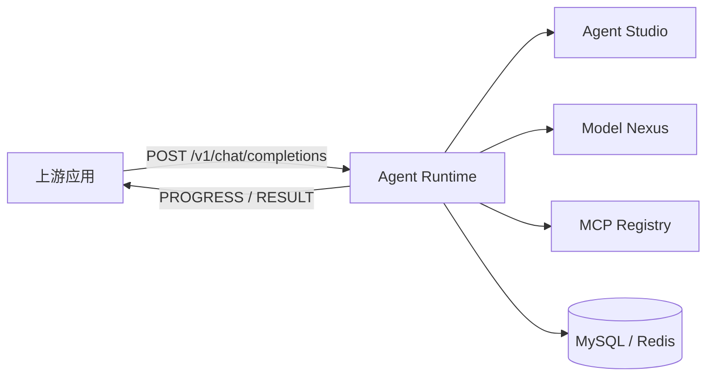

<p align="center">
  
</p>

# g2rain-agent-runtime

> 下一代AI软件开发范式，AI原生Agent平台，开源的企业级SaaS底座。

谷雨 Agent 的运行时执行服务。它把 Agent 配置、用户输入、模型能力和工具能力组织为可追踪、可恢复的任务执行过程，并通过 SSE 持续返回对话进度与最终结果。

[官网](https://www.g2rain.com) · [Issues](https://github.com/g2rain/g2rain/issues) · [Discussions](https://github.com/g2rain/g2rain/discussions)

## 平台定位

`g2rain-agent-runtime` 位于谷雨 AI Agent 平台的执行层：它加载 Agent Studio 管理的 Agent 与技能配置，经 Model Nexus 调用模型、经 MCP Registry 调用工具，并把可追踪的任务状态和流式结果提供给上游应用。

## 功能概览

| 能力 | 说明 |
| --- | --- |
| 流式对话执行 | `POST /v1/chat/completions` 返回 `text/event-stream`；一轮对话推送过程事件并以结果事件收口。 |
| 任务图与状态 | 维护任务实例、节点、边、节点载荷与状态迁移，支撑多步骤 Agent 执行。 |
| 检查点与恢复 | 持久化检查点和恢复记录，使任务可在安全边界继续。 |
| 工具编排 | 统一调度内置工具和 MCP 工具，并记录调用过程与结果。 |

## 核心流程



1. 调用方提交一轮对话请求；Runtime 创建或续接会话，并注册 SSE 连接。
2. Runtime 根据 Agent 与 Skill 配置构建执行流程，协调模型与工具调用。
3. 执行过程写入任务图、节点载荷和工具调用记录，并推送 `PROGRESS` 事件。
4. Runtime 写入任务终态，推送唯一的 `RESULT` 事件并关闭连接。

任务中断后，Runtime 根据检查点、恢复记录及工具调用的幂等信息，选择安全边界继续，避免无依据地重放可能产生副作用的调用。

## 工程结构

| 模块 | 说明 |
| --- | --- |
| `g2rain-agent-runtime-api` | 定义运行时 API、DTO、VO 与枚举契约。 |
| `g2rain-agent-runtime-biz` | 实现会话、任务、状态、工具、持久化及 Web 接口。 |
| `g2rain-agent-runtime-startup` | 组装 Spring Boot、虚拟线程、参数解析和环境配置。 |
| `docs/` | 维护项目架构、状态、SSE、技能、契约、运维与安全文档。 |

模块依赖方向固定为：`startup → biz → api`。

## 本地启动

前置条件：JDK 25、Maven，以及可用的 MySQL、Redis 与所依赖的服务。运行时默认使用 `nacos` 配置；本地联调可显式启用 `dev` profile，并在本机安全地配置数据源和依赖服务。

```powershell
mvn -pl g2rain-agent-runtime-startup -am spring-boot:run "-Dspring-boot.run.profiles=dev"
```

默认端口由 `SERVER_PORT` 控制，未设置时为 `8080`。生产或共享环境请通过 Nacos 及环境变量提供配置，不要将凭据提交到仓库。

## 配置说明

| 配置项 | 说明 |
| --- | --- |
| `SERVER_PORT` | HTTP 端口；未设置时为 `8080`。 |
| `SPRING_PROFILES_ACTIVE` | 默认 `nacos`；`dev` 与 `nacos` 不应同时激活。 |
| `NACOS_SERVER_ADDR` | Nacos 注册与配置中心地址。 |
| `G2RAIN_MODEL_NEXUS_ENDPOINT` | Model Nexus 服务端点。 |
| `G2RAIN_MCP_REGISTRY_ENDPOINT` | MCP Registry 服务端点；MCP 路径默认为 `/mcp`。 |

真实凭据、密钥和环境地址仅应通过 Secret、环境变量或受控配置中心提供。

## 构建与验证

| 目标 | 命令 | 说明 |
| --- | --- | --- |
| 构建与验证 | `mvn clean verify` | 执行 Maven 验证生命周期。 |
| 构建本地镜像 | `./build.sh <tag>` | 使用 Jib 构建 `g2rain/g2rain-agent-runtime:<tag>`。 |

## 接口说明

| 接口 | 用途 |
| --- | --- |
| `POST /v1/chat/completions` | 提交渠道、可选 Agent/会话、用户输入或恢复动作；以 SSE 返回 `PROGRESS` 与 `RESULT` 事件。 |
| `GET /task_instance/list`、`GET /task_instance/page` | 查询任务实例。 |
| `POST /task_checkpoint/save` | 保存任务检查点。 |
| `POST /task_resume_record/save` | 保存任务恢复记录。 |
| `POST /tool_call_record/save` | 保存工具调用记录。 |

完整的请求字段、事件顺序和客户端处理方式见 [SSE 事件约定](docs/SSE_EVENTS.md)。

## 关联模块

- **Agent Studio**：维护运行所需的 Agent 配置与技能资料。
- **MCP Registry**：提供可发现、可调用的 MCP 工具服务。
- **Model Nexus**：统一访问聊天、嵌入等模型能力。

## 职责边界

本仓库负责 Agent 对话、任务图和节点编排，以及运行状态、检查点、恢复记录和工具调用记录的持久化。

本仓库不负责编辑 Agent/Skill 配置、登记 MCP 工具、管理模型供应商密钥，也不承担网关鉴权、统一路由或部署编排。

## 运维与安全

- 健康检查：`GET /actuator/health`；指标、健康与信息端点的访问权限由部署环境控制。
- 任务、节点、工具调用和请求关联 ID 应贯穿日志与排障；日志不得记录提示词全文、Token、密钥或工具敏感载荷。
- 工具调用可能产生外部副作用；恢复或重试前必须依据调用记录和幂等策略判定。
- 服务无法启动时，优先检查激活的 profile、Nacos、MySQL、Redis，以及 Studio、Model Nexus、MCP Registry 的连通性。

## 文档入口

- [项目文档索引](docs/index.md)
- [运行状态模型](docs/STATE_SPEC.md)
- [SSE 事件约定](docs/SSE_EVENTS.md)
- [技能使用指南](docs/SKILL_GUIDE.md)
- [接口契约](docs/CONTRACT_SPEC.md)
- [已知问题](docs/KNOWN_ISSUES.md)

## 参与贡献

欢迎通过 Issue、文档改进、功能建议和 Pull Request 参与贡献。提交前请补充必要的测试与文档，执行 `mvn clean verify`，并确认状态、事件、契约、配置及部署说明与变更保持一致。
