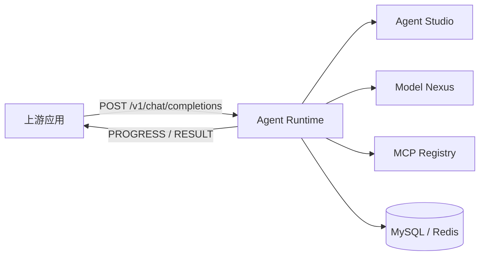

<p align="center">
  
</p>

# g2rain-agent-runtime

[](LICENSE)
[](https://openjdk.org/)
[](https://spring.io/projects/spring-boot)
[](https://spring.io/projects/spring-cloud)
[](https://maven.apache.org/)

G2rain（谷雨）是面向企业的开源智能体平台，连接模型、知识与业务工具，以 SaaS 基座和应用开发工具链支撑智能应用落地。智能体平台已开源，具体组件、版本与接入方式以各责任仓库的说明为准。`g2rain-agent-runtime` 是其中的 Agent 运行时执行服务：它把 Agent 配置、用户输入、模型能力和工具能力组织为可追踪、可恢复的任务执行过程，并通过 SSE 持续返回对话进度与最终结果；它不代表或替代整个平台能力。

[官网](https://www.g2rain.com) · [完整文档](docs/index.md) · [中央架构 Profile](https://github.com/g2rain/g2rain/tree/architecture-v1.0.0/docs/architecture/profiles/java-domain-service) · [架构说明](docs/architecture/overview.md) · [代码规范](docs/development/code-conventions.md) · [Issues](https://github.com/g2rain/g2rain/issues) · [Discussions](https://github.com/g2rain/g2rain/discussions)

## 项目定位

`g2rain-agent-runtime` 位于平台 Agent 执行层：它加载 Agent Studio 管理的 Agent 与技能配置，经 Model Nexus 调用模型、经 MCP Registry 调用工具，并把可追踪的任务状态和流式结果提供给上游应用。平台的 SaaS 基座、知识库、部署编排、身份权限、前端应用与商业化规划分别由其他组件和文档负责。

## 功能概览

| 能力 | 说明 |
| --- | --- |
| 流式对话执行 | `POST /v1/chat/completions` 返回 `text/event-stream`；一轮对话推送过程事件并以结果事件收口。 |
| 任务图与状态 | 维护任务实例、节点、边、节点载荷与状态迁移，支撑多步骤 Agent 执行。 |
| 检查点与恢复 | 持久化检查点和恢复记录，使任务可在安全边界继续。 |
| 工具编排 | 统一调度内置工具和 MCP 工具，并记录调用过程与结果。 |

## 核心流程



1. 调用方提交一轮对话请求；Runtime 创建或续接会话，并注册 SSE 连接。
2. Runtime 根据 Agent 与 Skill 配置构建执行流程，协调模型与工具调用。
3. 执行过程写入任务图、节点载荷和工具调用记录，并推送 `PROGRESS` 事件。
4. Runtime 写入任务终态，推送唯一的 `RESULT` 事件并关闭连接。

任务中断后，Runtime 根据检查点、恢复记录及工具调用的幂等信息，选择安全边界继续，避免无依据地重放可能产生副作用的调用。

## 工程结构

| 模块 | 说明 |
| --- | --- |
| `g2rain-agent-runtime-api` | 定义运行时 API、DTO、VO 与枚举契约。 |
| `g2rain-agent-runtime-biz` | 实现会话、任务、状态、工具、持久化及 Web 接口。 |
| `g2rain-agent-runtime-startup` | 组装 Spring Boot、虚拟线程、参数解析和环境配置。 |
| `docs/` | 维护项目架构、状态、SSE、技能、契约、运维与安全文档。 |

模块依赖方向固定为：`startup → biz → api`。

## 技术栈

| 类别 | 技术 |
| --- | --- |
| 运行时 | Java 25、Spring Boot 4.1.2、Spring Cloud 2025.1.4、Spring AI 2.0.2 |
| 数据访问与状态 | MyBatis、MySQL、Redis、Redisson |
| 平台集成 | Nacos、OpenFeign、MCP SDK、Agent Studio、Model Nexus、MCP Registry |
| API 与文档 | Spring Web、Jakarta Validation、OpenAPI、SSE |
| 构建与部署 | Maven、Jib、Docker |
| 测试 | JUnit 5、Spring Boot Test |

## 快速开始

### 环境

- JDK 25
- Maven 3.9+
- MySQL、Redis、Nacos
- Agent Studio、Model Nexus、MCP Registry

运行时默认使用 `nacos` 配置；本地联调可显式启用 `dev` profile，并在本机安全地配置数据源和依赖服务。

### 构建与测试

```bash
mvn clean verify
```

### 启动服务

```powershell
mvn -pl g2rain-agent-runtime-startup -am spring-boot:run "-Dspring-boot.run.profiles=dev"
```

默认端口由 `SERVER_PORT` 控制，未设置时为 `8080`。生产或共享环境请通过 Nacos 及环境变量提供配置，不要将凭据提交到仓库。

## 配置说明

| 配置项 | 说明 |
| --- | --- |
| `SERVER_PORT` | HTTP 端口；未设置时为 `8080`。 |
| `SPRING_PROFILES_ACTIVE` | 默认 `nacos`；`dev` 与 `nacos` 不应同时激活。 |
| `NACOS_SERVER_ADDR` | Nacos 注册与配置中心地址。 |
| `G2RAIN_MODEL_NEXUS_ENDPOINT` | Model Nexus 服务端点。 |
| `G2RAIN_MCP_REGISTRY_ENDPOINT` | MCP Registry 服务端点；MCP 路径默认为 `/mcp`。 |

真实凭据、密钥和环境地址仅应通过 Secret、环境变量或受控配置中心提供。

## 构建与验证

| 目标 | 命令 | 说明 |
| --- | --- | --- |
| 构建与验证 | `mvn clean verify` | 执行 Maven 验证生命周期。 |
| 构建本地镜像 | `./build.sh 1.0.0` | 先执行完整 Maven 构建与测试，再用 Jib 构建并载入本地 Docker。需要 Docker daemon。 |

## GHCR 镜像

镜像成功后自动调用 API Maven 发布工作流；也可手动运行 `publish-maven.yml`（所选提交须属于 `main`）。API 坐标为 `com.g2rain:g2rain-agent-runtime-api:1.0.0`，仓库为 `https://maven.pkg.github.com/g2rain/g2rain-agent-runtime`，消费认证见部署文档。

- 镜像地址：`ghcr.io/g2rain/g2rain-agent-runtime`。
- 稳定版使用 `1.0.0` 这类版本标签，并同时发布 `sha-<完整提交 SHA>` 可追溯标签；不会更新 `latest`。
- 包公开后可拉取：`docker pull ghcr.io/g2rain/g2rain-agent-runtime:1.0.0`。
- 仅推送精确格式的 `v<major>.<minor>.<patch>` Git tag 才会触发发布；tag 提交必须在 `main` 历史中，并含同名发布说明和匹配的 Maven 版本。普通分支、Pull Request 和手动触发不会发布。

完整的 GHCR 权限、首次公开、发布顺序、配置与部署说明见[构建与部署](docs/operations/deployment.md#ghcr-发布)。镜像发布不代表在线演示可用，也不代表已在目标环境完成部署验证。

## 接口说明

| 接口 | 用途 |
| --- | --- |
| `POST /v1/chat/completions` | 提交渠道、可选 Agent/会话、用户输入或恢复动作；以 SSE 返回 `PROGRESS` 与 `RESULT` 事件。 |
| `GET /task_instance/list`、`GET /task_instance/page` | 查询任务实例。 |
| `POST /task_checkpoint/save` | 保存任务检查点。 |
| `POST /task_resume_record/save` | 保存任务恢复记录。 |
| `POST /tool_call_record/save` | 保存工具调用记录。 |

完整的请求字段、事件顺序和客户端处理方式见 [SSE 事件约定](docs/SSE_EVENTS.md)。

## 关联模块

- **Agent Studio**：维护运行所需的 Agent 配置与技能资料。
- **MCP Registry**：提供可发现、可调用的 MCP 工具服务。
- **Model Nexus**：统一访问聊天、嵌入等模型能力。

## 职责边界

本仓库负责 Agent 对话、任务图和节点编排，以及运行状态、检查点、恢复记录和工具调用记录的持久化。

本仓库不负责编辑 Agent/Skill 配置、登记 MCP 工具、管理模型供应商密钥，也不承担网关鉴权、统一路由或部署编排。

## 运维与安全

- 健康检查：`GET /actuator/health`；指标、健康与信息端点的访问权限由部署环境控制。
- 任务、节点、工具调用和请求关联 ID 应贯穿日志与排障；日志不得记录提示词全文、Token、密钥或工具敏感载荷。
- 工具调用可能产生外部副作用；恢复或重试前必须依据调用记录和幂等策略判定。
- 服务无法启动时，优先检查激活的 profile、Nacos、MySQL、Redis，以及 Studio、Model Nexus、MCP Registry 的连通性。

## 项目文档

| 场景 | 入口 |
| --- | --- |
| 文档首页 | [docs/index.md](docs/index.md) |
| 中央基线与项目差异 | [Java Domain Service 1.0.0](https://github.com/g2rain/g2rain/tree/architecture-v1.0.0/docs/architecture/profiles/java-domain-service) · [接入项](docs/architecture/deviations.md) |
| 架构与模块职责 | [架构总览](docs/architecture/overview.md) · [模块职责](docs/architecture/modules.md) |
| 运行状态与接口 | [状态模型](docs/STATE_SPEC.md) · [SSE 事件](docs/SSE_EVENTS.md) · [接口契约](docs/CONTRACT_SPEC.md) |
| 本地开发与测试 | [本地开发](docs/development/local-development.md) · [测试策略](docs/development/testing.md) |
| 配置、安全与运维 | [配置说明](docs/operations/configuration.md) · [安全边界](docs/security/security-boundaries.md) · [可观测性](docs/operations/observability.md) |
| 镜像与部署 | [构建与部署](docs/operations/deployment.md) |
| 发布记录 | [docs/releases/README.md](docs/releases/README.md) |
| 已知问题 | [docs/KNOWN_ISSUES.md](docs/KNOWN_ISSUES.md) |

## 参与贡献

欢迎通过 Issue、文档改进、功能建议和 Pull Request 参与贡献。提交前请补充必要的测试与文档，执行 `mvn clean verify`，并确认状态、事件、契约、配置及部署说明与变更保持一致。
