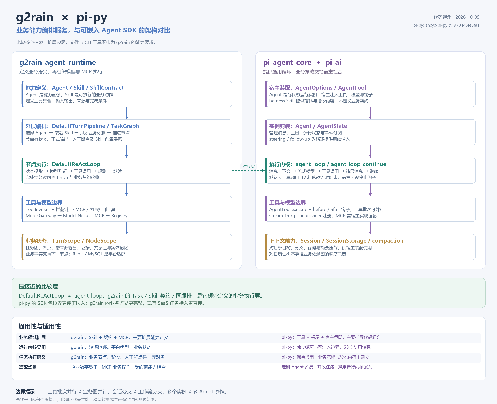
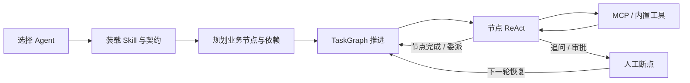
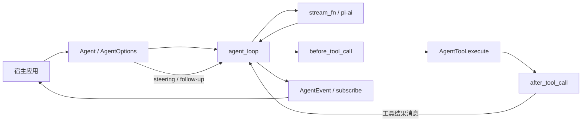
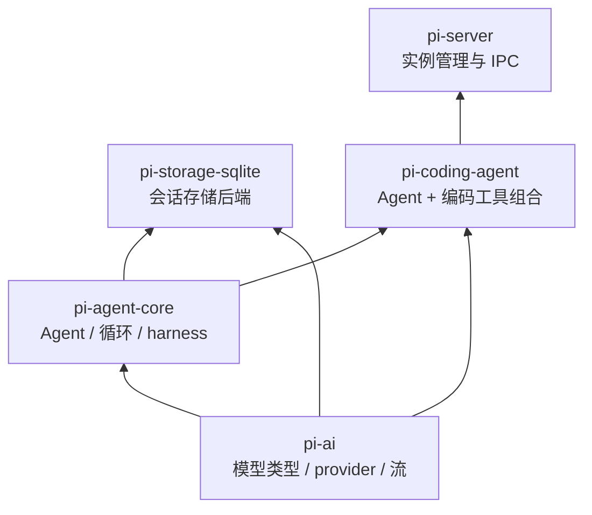

# g2rain-agent-runtime 与 pi-py 架构对比

日期：2026-10-05。

## 对比范围与源码基线

- g2rain-agent-runtime：当前工作区代码，Git HEAD 为 `57c63797457fc530865ad97b7303e02739db747f`。已有修改主要为文档；本次未修改执行代码。
- pi-py：公开仓库 [encyc/pi-py](https://github.com/encyc/pi-py)，本次读取的提交为 `978448fe3fa1705a54e58a01359a620b4ea432d8`。
- 对比核心抽象、职责边界、编排方式、工具协议、状态模型、扩展性与适用性。文件访问、CLI 和编码工具不作为 g2rain 的能力要求。
- 结论来自源码静态分析，没有进行性能、模型效果或生产稳定性对比测试。不将 TypeScript 上游 Pi 的能力直接视为 Python 仓库已经实现的能力。

## 核心判断

**pi-py 提供可嵌入的通用 Agent 运行内核；g2rain 提供具有业务任务语义的 SaaS Agent 编排服务。**

最接近的对比层是 `DefaultReActLoop` 与 `agent_loop`。g2rain 的任务生命周期、Skill 契约、业务依赖图、正式输出与人工断点，是它在通用模型工具循环之上额外建立的业务执行层。

因此，两个方向的判断不同：

- **作为可嵌入的运行内核，pi-py 的包边界与宿主注入方式更通用。**
- **作为当前 G2Rain 平台的业务执行服务，g2rain 的能力组合、业务数据与人工参与语义更完整。**

## 架构对照图

[查看可缩放的 SVG 原图](pi-py-comparison.svg)

图按核心职责进行映射，表达调用顺序与概念层次，不是完整 UML 依赖图。pi-py 的 Session、技能加载与上下文压缩是可供宿主使用的 harness 组件，并不表示默认 Agent 已自动串联所有组件。

## 一、核心对象：相同名称，不同职责

| 对象 | g2rain-agent-runtime | pi-py |
|---|---|---|
| Agent | 选定的能力画像与 Skill 范围，作为任务的能力归属 | 有状态运行实例，管理消息、工具、运行生命周期与事件 |
| Skill | 业务动作单元：语义、手册、工具集合、输入输出及完成契约 | 指令内容单元：名称、描述、正文、路径等元数据 |
| Task / Node | 显式业务任务与技能节点，组织依赖、状态和产出 | 核心循环没有对应的业务任务图对象，由宿主自行构建 |
| 执行上下文 | 任务、节点、输入输出、共享值、证据与模型投影 | 消息、system prompt、工具与模型调用配置 |
| 完成 | 内置 finish 动作结合契约、输出和证据进行验收 | 默认循环无后续工具调用及排队输入时结束，亦可由钩子或工具结果控制停止 |

pi-py 的 `Agent` 与 g2rain 的 `AgentSelection` 并不是同一层次的对象。g2rain 的 Agent 偏向业务能力定义，运行实例由本轮与任务状态承接；pi-py 的 Agent 本身就是运行实例。

这个区别会影响产品架构：g2rain 更自然地围绕“数字员工拥有哪些能力、当前任务属于谁”组织；pi-py 更自然地围绕“宿主怎样配置和运行一个 Agent 实例”组织。

## 二、控制结构：任务编排与通用循环

### g2rain：显式业务图包围节点循环

计划是运行时可读取的业务结构。节点具备技能、目标、依赖、状态和正式产出；动作内部的工具选择仍交给 ReAct。

优势在于业务过程可以按节点表达和观察，能力之间具有显式依赖。劣势在于业务节点统一进入 ReAct，新的执行类型与图控制语义需要扩展核心结构。

### pi-py：宿主围绕通用循环注入策略

循环负责模型消息、工具调用和事件推进，宿主提供上下文转换、模型流、工具及停止策略。业务如何分解、何时批准、哪些事实算正式产出，没有在核心循环中预先定义。

优势是内核可以嵌入不同产品。劣势是要构建企业业务执行服务，宿主还要建立能力目录、业务任务、依赖、验收和人工交互模型。

pi-py 的循环内部也有两层循环，但分别处理工具调用与 steering、以及停止后的 follow-up；它们不对应 g2rain 的“业务任务图外层 + 节点执行内层”。

## 三、扩展性：声明式能力扩展与宿主代码组合

| 扩展方向 | g2rain-agent-runtime | pi-py |
|---|---|---|
| 增加业务能力 | 在既有契约语义内，主要增加 Skill 定义与 MCP 工具 | 增加 AgentTool、提示内容，并由宿主建立业务策略 |
| 定制上下文 | 修改或替换 PromptAssembler / Projection 相关实现 | 注入 transform_context / convert_to_llm 等边界 |
| 定制工具执行 | 统一 ToolInvoker 与多阶段拦截链 | AgentTool 协议及 before / after 钩子 |
| 模型接入 | ModelGateway 接入 Model Nexus，平台集中管理 | stream_fn 可注入，pi-ai 提供 provider 注册协议 |
| 替换会话存储 | 运行状态与平台任务持久化结构一起适配 | SessionStorage 定义可替换会话后端协议 |
| 新业务控制语义 | 核心已有追问、批准、核验、完成与技能委派 | 核心保持通用，业务控制由宿主补充 |
| 嵌入其他产品 | 当前服务结构与平台类型耦合较深 | 独立包与可注入循环更便于 SDK 嵌入 |

两者的扩展优势不能简单归为“谁插件更多”。

**g2rain 的优势是，在已经定义的业务执行语义内，能力扩展可以主要发生在配置和契约中。pi-py 的优势是，不预设同一套业务执行语义，宿主可以按不同产品需求组合循环、工具和策略。**

对应的代价也不同：g2rain 需要保持工具集合、手册、契约与 MCP Schema 的一致性；pi-py 宿主需要承担更多产品语义的编码和集成工作。

## 四、数据模型：业务事实与消息内容

### g2rain 的数据中心是业务执行事实

`TurnScope / NodeScope` 明确分开会话、任务和节点状态。工具观测进入证据，正式输出带有来源，输出可进入下游节点或共享值，实体可形成任务前情。

它适合“查出对象 → 选择对象 → 获取前置数据 → 执行业务动作”的链路。模型对事实的叙述与可复用的正式业务产出具有不同身份。

其正式输出拒绝 MODEL 来源，因此模型自由生成的内容不会自动获得正式业务事实的地位。生成解释和最终回复仍然可行；如果需要模型生成内容进入后续正式数据链，通常还需要独立适配。

### pi-py 的数据中心是消息与工具结果

`AgentState` 保存消息、工具和当前运行状态；`AgentToolResult` 区分给模型的 `content` 与给宿主的 `details`。消息和工具结果内容支持文本与图片表达。

这使模型生成内容可以自然成为对话结果，也便于宿主处理额外结构化详情。但核心没有将这些结果组织成带来源的业务节点输入输出；业务事实的权威性和跨步骤数据关系仍由宿主定义。

这不是存储选型的差异，而是两者对“运行结果是什么”的建模差异。

## 五、四组容易混淆的能力

### 1. Skill 指令不等于 Skill 执行契约

pi-py harness 的 Skill 加载名称、描述和正文，并提供提示格式化函数。g2rain 的 Skill 还定义工具范围、参数来源、输入输出和完成条件。

前者让模型理解方法，后者同时让 Runtime 判断业务执行是否成立。g2rain 在可约束的业务能力方面表达更完整；pi-py 的指令形式更轻，执行约束由宿主承担。

### 2. Session 分支不等于业务工作流分支

pi-py 的 Session 用 parent_id、leaf、fork 和 move_to 组织对话条目历史。g2rain 的 TaskGraph 用依赖边组织业务节点推进。

因此，pi-py 的会话树不能直接视为业务 DAG 调度器；g2rain 的任务图也不能直接视为对话历史的分支浏览系统。

### 3. 工具批次并行不等于业务图并行

pi-py 可以并发运行一次模型响应中的工具调用，亦支持顺序执行。这是模型循环内部的工具批次语义。

g2rain 当前逐个推进业务节点。它的任务图可以表达多前驱依赖，但当前执行不是并行图调度。

两者处于不同粒度。pi-py 有工具批次并行，并不因此具有跨业务节点的工作流引擎。

### 4. 多个 Agent 实例不等于多 Agent 协作

pi-server 的 Supervisor 管理多个进程内 CodingAgent 实例，并提供实例级 RPC 与事件订阅；没有因此形成业务角色分工、任务委派和结果汇合。

g2rain 的 delegate 则插入当前技能集合中的前置 Skill 节点，也不是创建独立 Agent。

两者目前都不能仅凭“委派”或“多个实例”认定为完整的多 Agent 协作架构。

## 六、包边界与服务边界

pi-py 的包依赖体现了较清楚的 SDK 组合：

核心循环不需要知道 Unix socket、编码工具或 SQLite 才能工作。会话存储通过协议表达，模型流通过可注入函数与 provider 协议表达。这些边界有利于独立内核复用。

但不能把包中“存在 harness 组件”等同于产品层“已自动装配这些能力”。源码中的默认 CodingAgent 主要组合 Agent、工具和提示；技能、Session 树与 compaction 还需要宿主装配使用。pi-server 的 IPC 与实例管理也不是现成的企业 SaaS 业务执行平台。

g2rain 的模块主要按平台服务工程组织。模型适配、能力装载、编排、状态和工具实现集中于业务模块，并直接使用 Studio、Nexus 及平台身份类型。这有利于服务接入现有 G2Rain 体系，但削弱了执行内核的独立可移植性。

## 七、优势、劣势与适用性

| 维度 | g2rain-agent-runtime | pi-py |
|---|---|---|
| 主要优势 | 业务能力目录、节点执行、正式产出、验收与人工参与具有共同模型 | 通用循环、事件、工具与模型边界可嵌入、可由宿主组合 |
| 主要代价 | 执行范式较固定，平台耦合较深，能力定义的维护责任较重 | 产品语义留给宿主，构建业务执行平台需要补充更多上层结构 |
| 业务领域通用性 | 较强，可用 Skill 契约与 MCP 接入多个领域 | 较强，可用不同工具与宿主策略接入多个领域 |
| 内核复用通用性 | 当前更适合平台内服务复用 | SDK 嵌入能力更强 |
| 业务执行完整性 | 已建立显式任务、技能节点与验收数据模型 | 核心不预设这些业务语义，需要宿主建立 |
| 开放生成任务 | 可以生成回复，但正式产出体系偏向带来源事实 | 消息模型更自然地接纳模型生成结果 |
| 企业 MCP 操作服务 | 当前目标直接匹配 | 需要补 MCP 适配与业务执行层 |
| 复杂工作流 | 现有图语义仍有限 | 通用循环本身也不提供业务 DAG 引擎 |
| 多 Agent 协作 | 技能委派，不是独立 Agent 协作 | 多实例管理，不是协作编排 |

对于“以编排和 MCP 为主、不提供文件与 CLI 能力”的当前目标，**g2rain 的总体方向比直接使用 pi-py 核心更贴近需求**：它已经表达业务能力和业务执行结果。

对于“建设可被多种产品嵌入的运行内核”，**pi-py 的 SDK 边界与宿主策略注入方式更值得参考**。这并不要求 g2rain 放弃现有 Skill 契约与证据体系；可以保留业务编排层，再使节点循环、模型、工具和状态边界更独立。

值得借鉴的是内核与宿主的边界，不是把 g2rain 的业务图改造成对话历史树，也不是把指令型 Skill 直接替换为业务契约型 Skill。

## 八、主要源码依据

### pi-py（固定提交链接）

- [Agent / AgentOptions](https://github.com/encyc/pi-py/blob/978448fe3fa1705a54e58a01359a620b4ea432d8/packages/pi-agent-core/src/pi_agent_core/agent.py)
- [agent_loop 与工具执行](https://github.com/encyc/pi-py/blob/978448fe3fa1705a54e58a01359a620b4ea432d8/packages/pi-agent-core/src/pi_agent_core/agent_loop.py)
- [AgentTool / AgentToolResult / AgentState / AgentLoopConfig](https://github.com/encyc/pi-py/blob/978448fe3fa1705a54e58a01359a620b4ea432d8/packages/pi-agent-core/src/pi_agent_core/types.py)
- [harness Skill](https://github.com/encyc/pi-py/blob/978448fe3fa1705a54e58a01359a620b4ea432d8/packages/pi-agent-core/src/pi_agent_core/harness/skills.py)
- [Session / SessionStorage](https://github.com/encyc/pi-py/blob/978448fe3fa1705a54e58a01359a620b4ea432d8/packages/pi-agent-core/src/pi_agent_core/harness/session.py)
- [上下文压缩](https://github.com/encyc/pi-py/blob/978448fe3fa1705a54e58a01359a620b4ea432d8/packages/pi-agent-core/src/pi_agent_core/harness/compaction.py)
- [provider 注册协议](https://github.com/encyc/pi-py/blob/978448fe3fa1705a54e58a01359a620b4ea432d8/packages/pi-ai/src/pi_ai/models.py)
- [CodingAgent 默认组合](https://github.com/encyc/pi-py/blob/978448fe3fa1705a54e58a01359a620b4ea432d8/packages/pi-coding-agent/src/pi_coding_agent/sdk.py)
- [Supervisor 多实例管理](https://github.com/encyc/pi-py/blob/978448fe3fa1705a54e58a01359a620b4ea432d8/packages/pi-server/src/pi_server/supervisor.py)

### g2rain-agent-runtime（项目内链接）

- [DefaultTurnPipeline](../g2rain-agent-runtime-biz/src/main/java/com/g2rain/agent/runtime/engine/DefaultTurnPipeline.java)
- [Skill](../g2rain-agent-runtime-biz/src/main/java/com/g2rain/agent/runtime/domain/hydrate/Skill.java)
- [SkillContract](../g2rain-agent-runtime-biz/src/main/java/com/g2rain/agent/runtime/domain/hydrate/SkillContract.java)
- [TaskGraph](../g2rain-agent-runtime-biz/src/main/java/com/g2rain/agent/runtime/domain/graph/TaskGraph.java)
- [DefaultNodeRunner](../g2rain-agent-runtime-biz/src/main/java/com/g2rain/agent/runtime/engine/flow/graph/DefaultNodeRunner.java)
- [DefaultReActLoop](../g2rain-agent-runtime-biz/src/main/java/com/g2rain/agent/runtime/engine/flow/react/DefaultReActLoop.java)
- [DefaultToolInvoker](../g2rain-agent-runtime-biz/src/main/java/com/g2rain/agent/runtime/engine/tools/DefaultToolInvoker.java)
- [DefaultFinishPolicy](../g2rain-agent-runtime-biz/src/main/java/com/g2rain/agent/runtime/engine/tools/finish/DefaultFinishPolicy.java)
- [ControlBuiltinTools](../g2rain-agent-runtime-biz/src/main/java/com/g2rain/agent/runtime/engine/tools/builtin/ControlBuiltinTools.java)
- [NodeBuiltinTools](../g2rain-agent-runtime-biz/src/main/java/com/g2rain/agent/runtime/engine/tools/builtin/NodeBuiltinTools.java)
- [TurnScope](../g2rain-agent-runtime-biz/src/main/java/com/g2rain/agent/runtime/domain/state/TurnScope.java)
- [ModelGateway](../g2rain-agent-runtime-biz/src/main/java/com/g2rain/agent/runtime/engine/model/ModelGateway.java)

相关文档：[整体架构评估](../reviews/architecture-review.md) · [Java 类架构与执行逻辑](../java-class-architecture.md)。
