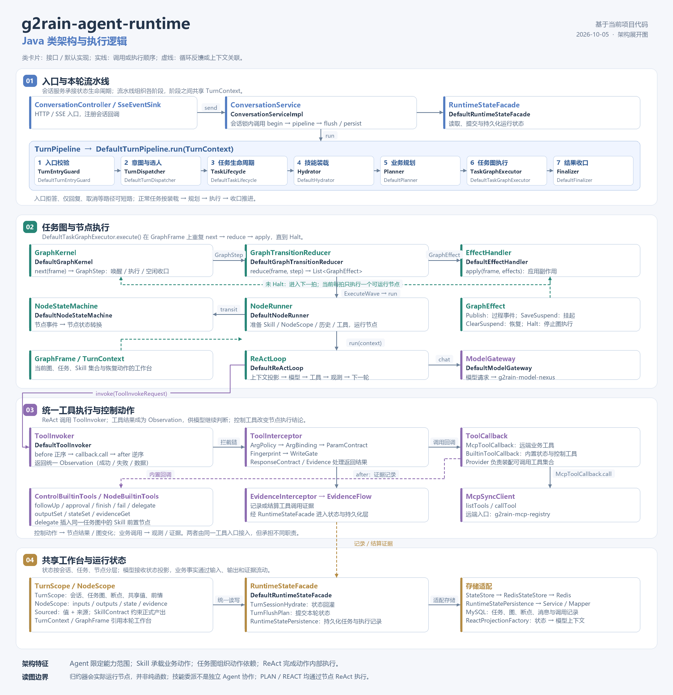

# Java 类架构与执行逻辑

日期：2026-10-05。依据：当前项目 Java 代码。

[查看可缩放的 SVG 原图](java-class-architecture.svg)

## 读图说明

图按四个职责区域展开。类卡片列出接口与默认实现；实线表示调用或执行顺序，虚线表示循环反馈或上下文关联。它是类职责与执行逻辑的组合图，不是完整 UML 类图，也不列出所有注入依赖。

1. **入口与本轮流水线。** `ConversationController` 经 `SseEventSink` 注册会话回调，`ConversationServiceImpl` 在会话锁内执行状态回灌、流水线和提交。`DefaultTurnPipeline` 组织入口校验、决策、生命周期、能力装载、规划、图执行和收口，阶段之间共享 `TurnContext`。入口拒答、仅回复、取消等路径可以短路。
2. **任务图与节点执行。** `DefaultTaskGraphExecutor` 按 `graphKernel.next(frame)`、`graphTransitionReducer.reduce(frame, step)`、`effectHandler.apply(frame, effects)` 循环，直到图停止。归约器遇到 `ExecuteWave` 时直接调用 `DefaultNodeRunner`，不是纯函数式归约。节点执行准备技能、状态、历史和工具，再进入 `DefaultReActLoop`。节点状态转换由 `NodeStateMachine` 承担。
3. **统一工具执行。** ReAct 调用 `ToolInvoker`，调用前拦截器按正序运行，调用后按逆序运行。通过同一回调接口接入 MCP 业务工具与内置工具。业务工具返回观测和证据；内置控制工具表达追问、审批、完成、失败和技能委派。`delegate` 插入同一任务图的 Skill 前置节点，没有创建独立 Agent。
4. **共享工作台与运行状态。** `TurnScope` 承载会话和任务状态，`NodeScope` 承载节点输入、输出、私有状态和证据，`RuntimeStateFacade` 统一组织回灌、提交和持久化。`StateStore / RedisStateStore` 承担 Redis 适配，`RuntimeStatePersistence` 经 Service、Mapper 持久化到 MySQL。`ReactProjectionFactory` 把结构化状态投影为模型上下文。

图中的 `PLAN / REACT` 都沿用节点 ReAct 执行；这两个模式主要影响规划路径，并非两个独立节点执行器。

## 主要代码依据

- [ConversationServiceImpl](../g2rain-agent-runtime-biz/src/main/java/com/g2rain/agent/runtime/service/impl/ConversationServiceImpl.java)
- [DefaultTurnPipeline](../g2rain-agent-runtime-biz/src/main/java/com/g2rain/agent/runtime/engine/DefaultTurnPipeline.java)
- [DefaultTaskGraphExecutor](../g2rain-agent-runtime-biz/src/main/java/com/g2rain/agent/runtime/engine/flow/execute/DefaultTaskGraphExecutor.java)
- [DefaultGraphTransitionReducer](../g2rain-agent-runtime-biz/src/main/java/com/g2rain/agent/runtime/engine/flow/graph/DefaultGraphTransitionReducer.java)
- [DefaultNodeRunner](../g2rain-agent-runtime-biz/src/main/java/com/g2rain/agent/runtime/engine/flow/graph/DefaultNodeRunner.java)
- [DefaultReActLoop](../g2rain-agent-runtime-biz/src/main/java/com/g2rain/agent/runtime/engine/flow/react/DefaultReActLoop.java)
- [DefaultToolInvoker](../g2rain-agent-runtime-biz/src/main/java/com/g2rain/agent/runtime/engine/tools/DefaultToolInvoker.java)
- [ControlBuiltinTools](../g2rain-agent-runtime-biz/src/main/java/com/g2rain/agent/runtime/engine/tools/builtin/ControlBuiltinTools.java)
- [DefaultRuntimeStateFacade](../g2rain-agent-runtime-biz/src/main/java/com/g2rain/agent/runtime/engine/state/DefaultRuntimeStateFacade.java)

相关评估：[整体架构评估](reviews/architecture-review.md)。
