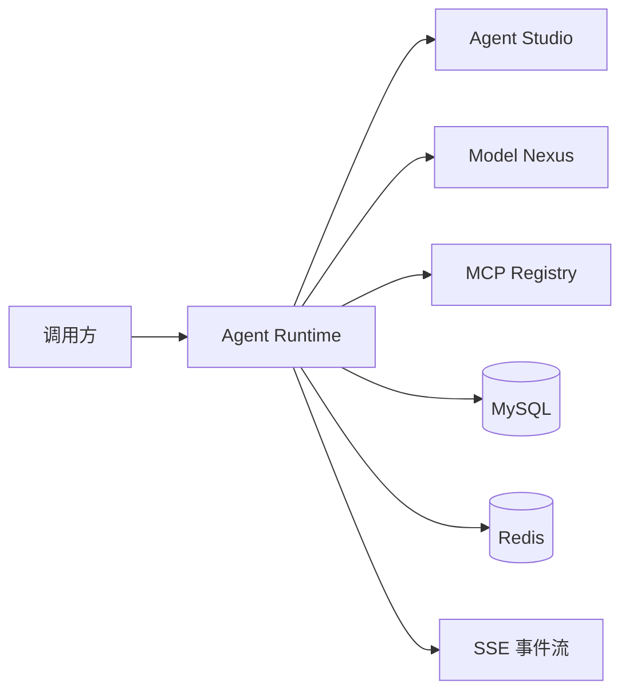

# 架构总览

`g2rain-agent-runtime` 是谷雨 Agent 的执行权威服务：它接收已配置的 Agent 任务，编排计划、节点、模型和工具调用，并持久化可恢复的执行状态。

## 核心领域

| 领域 | 代表对象 | 职责 |
| --- | --- | --- |
| 对话 | Conversation、Message | 管理会话上下文与增量输出。 |
| 任务执行 | Task Instance、Task Graph、Node | 生成、推进和收敛任务图。 |
| 状态恢复 | Checkpoint、Resume Record | 保存执行边界，支持中断后恢复。 |
| 工具调用 | Tool Call Record、MCP Callback | 调用内置或 MCP 工具并追踪结果。 |

## 非职责

- 不编辑 Agent、技能、版本或发布配置；这些由 Agent Studio 管理。
- 不登记 MCP 服务或工具元数据；这些由 MCP Registry 管理。
- 不直接承载供应商模型密钥或模型目录；这些由 Model Nexus 管理。
- 不取代 Gateway 的认证、路由与流量治理职责。
