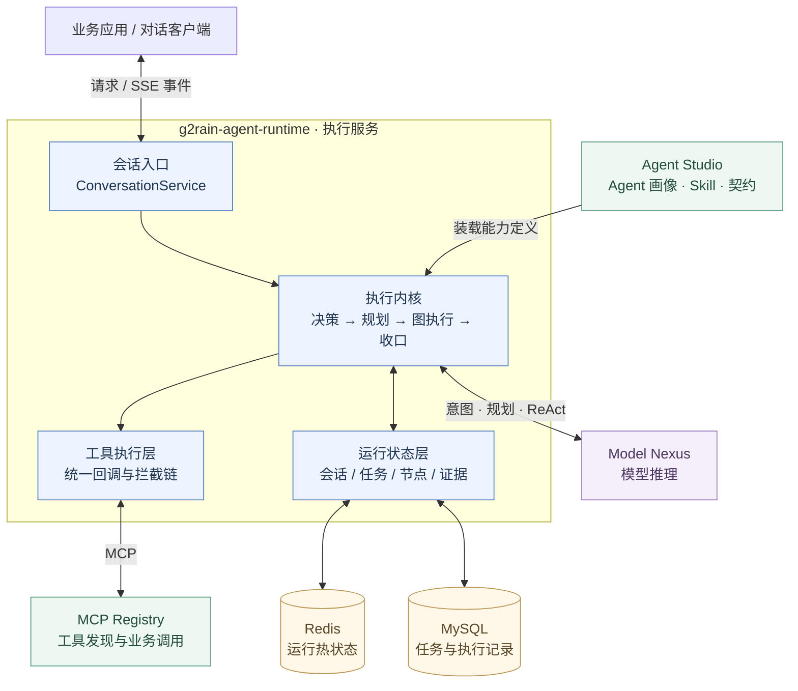
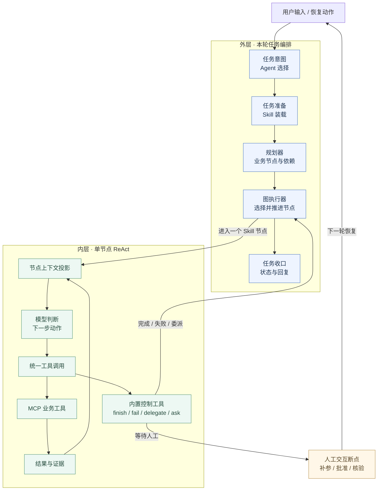
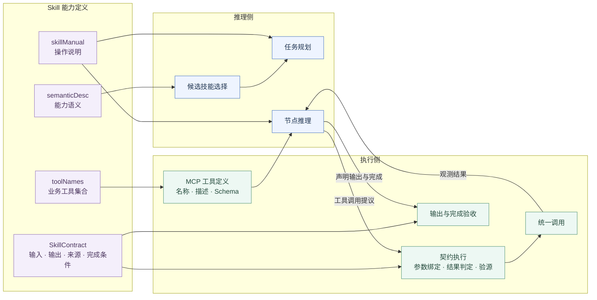
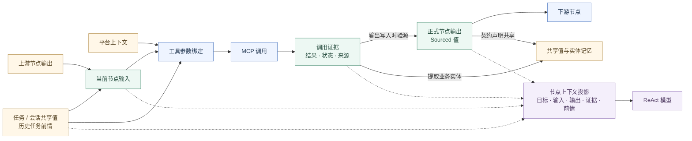
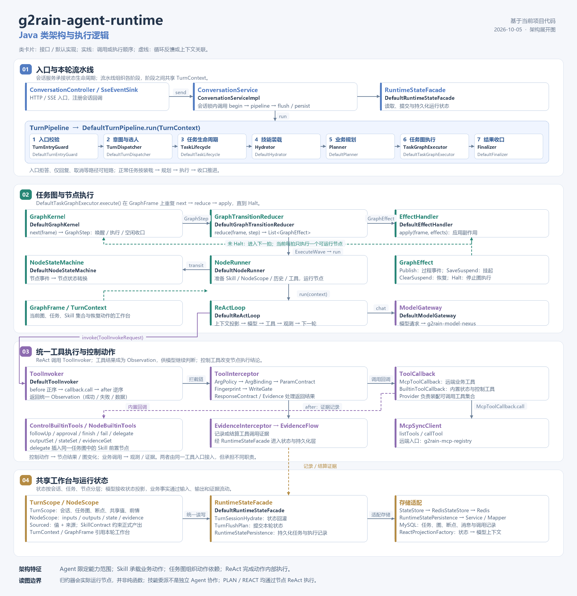

# g2rain-agent-runtime 整体架构评估

评估日期：2026-10-05  
评估对象：当前工作区中的 g2rain-agent-runtime 代码  
评估范围：整体系统架构、扩展性、业务通用性与适用性

## 评估依据与结论

本次评估以代码为事实依据，扫描 API、业务、启动模块，以及数据库、Mapper 和 Redis 脚本，重点追踪能力装载、任务规划、图执行、ReAct、工具调用、状态与证据之间的关系。文档中的设计声明不作为能力已经实现的依据。本次没有运行部署或故障注入验证。

项目定位为 SaaS 执行引擎，以编排和调用 MCP 为主。文件访问、CLI 和本地开发环境操作不属于本次评价中的能力要求。本评估不以局部代码错误、小的安全问题、版本、轮次或预算机制作为主线。

**从整体代码看，它是一套“以 Skill 为能力单元、任务图为编排骨架、ReAct 为节点执行器、契约与证据为约束”的 SaaS Agent 引擎。**

其通用性需要分开评价：**跨业务领域的通用性较强，执行范式的通用性有限；适合作为 G2Rain 平台内的统一执行服务，作为独立、可嵌入的引擎内核则有明显的平台耦合。**

以下四张图分别说明系统边界、控制结构、能力扩展和数据架构，描述当前代码中的关系。图中“跨业务通用性”“适用性”等结论是根据这些代码关系作出的架构判断。

## 一、系统边界：能力定义、推理、编排与业务执行

### 架构含义

Runtime 负责组织执行；Studio 提供能力定义；模型提供判断；业务操作通过 MCP 完成。文件访问和 CLI 不属于这套架构的职责。

代码中的业务扩展中心是技能和远端工具，没有在执行流程里写死订单、客户、部门等领域对象。因此，接入不同业务系统时，可以复用同一个执行服务。这是它跨业务通用性的主要来源。

### 优势

- 能力定义、推理、编排和业务调用的职责分工清楚。
- 业务能力通过 MCP 进入执行层，核心流程不需要承担每个业务系统的实现。
- 同一执行结构可以服务不同业务领域，适合平台统一建设数字员工与业务助手。

### 劣势与适用边界

平台依赖深入内核。Studio VO、Nexus 的模型请求与消息类型、平台身份上下文，都进入了编排代码。

当前 `api / biz / startup` 是服务工程分层；执行内核、平台适配、状态实现主要一起位于 `biz`。其中 API 模块主要暴露运行记录的查询接口，并没有形成独立的引擎内核与扩展协议模块。

因此，它在 G2Rain 体系内复用的适用性较好；把它拿到另一套平台中独立使用，需要适配的不只是几个连接地址，还包括能力、模型、身份和状态协议。

### 代码依据

- [会话入口 ConversationController](../g2rain-agent-runtime-biz/src/main/java/com/g2rain/agent/runtime/controller/ConversationController.java)
- [会话编排 ConversationServiceImpl](../g2rain-agent-runtime-biz/src/main/java/com/g2rain/agent/runtime/service/impl/ConversationServiceImpl.java)
- [能力来源 AgentProfiles](../g2rain-agent-runtime-biz/src/main/java/com/g2rain/agent/runtime/client/AgentProfiles.java)
- [模型边界 ModelGateway](../g2rain-agent-runtime-biz/src/main/java/com/g2rain/agent/runtime/engine/model/ModelGateway.java)
- [MCP 装配 McpClientConfig](../g2rain-agent-runtime-biz/src/main/java/com/g2rain/agent/runtime/config/McpClientConfig.java)
- [业务模块依赖](../g2rain-agent-runtime-biz/pom.xml)

## 二、控制结构：外层组织业务动作，内层完成动作

图展示逻辑控制关系，并不意味着每个动作都重新规划。续跑沿用已有任务图；仅回复和取消等模式会短路相应阶段。核验挂起还可以由节点执行器直接产生。

### 架构含义

**规划粒度和执行粒度分开，是这套引擎最有价值的控制结构。**

规划器决定“需要哪些业务动作、动作之间有什么依赖”；ReAct 决定“当前动作应该调用什么工具、怎样根据结果继续”。代码里的计划节点只有目标、技能和依赖等信息，工具选择与参数填写留给节点执行。

例如，查询客户、准备地址、创建订单可以是独立 Skill；某个 Skill 内部增加一次查询或补参，不必让全局规划器理解所有内部步骤。

图执行内部进一步拆分为 GraphKernel、GraphTransitionReducer、NodeRunner 和 EffectHandler，分别承担下一步选择、执行步骤处理、节点运行及副作用应用。这里是职责拆分，当前归约器会调用节点运行，并非纯函数式归约。

模型通过内置工具表达完成、失败、追问和委派，Runtime 把这些动作转换成节点状态和图推进。**模型拥有动作选择空间，控制状态由程序承接。** 人工交互因此是执行结构的一部分。

### 优势

- 业务动作组合与动作内部执行分开，规划与工具细节的耦合较低。
- 任务图给业务步骤提供结构，ReAct 保留步骤内部的适应性。
- 完成、失败、人工交互和委派使用统一的控制动作进入运行状态。
- 前置能力既可在规划时补入，也可在执行时由技能委派补入。

### 劣势与适用边界

**第一，任务以单个选定 Agent 的技能集合组织。** `delegate` 插入的是同一图中的 Skill 前置节点，没有创建独立 Agent。它支持能力组合，但当前结构并未提供多个独立 Agent 之间的协作。切换 Agent 会开启新的任务路径，而不是在同一图中建立多个 Agent 执行主体。

**第二，所有业务节点最终都进入 ReAct。** `PLAN / REACT` 主要影响规划路径，并没有形成两种独立的节点执行机制。因此，它擅长模型参与的业务操作；确定性流程也要沿用同一执行范式。

**第三，任务图表达的是业务依赖。** 当前执行逐节点推进，显式控制结构主要是依赖、挂起和技能委派。条件、循环、聚合等行为可以在 Skill 内部由模型处理，但没有成为图层的一等语义。

这不是“有没有图”的问题，而是图承载到哪一层语义。当前图负责组织业务动作，动作内部仍以模型驱动。

### 代码依据

- [本轮流水线 DefaultTurnPipeline](../g2rain-agent-runtime-biz/src/main/java/com/g2rain/agent/runtime/engine/DefaultTurnPipeline.java)
- [规划器 DefaultPlanner](../g2rain-agent-runtime-biz/src/main/java/com/g2rain/agent/runtime/engine/flow/plan/DefaultPlanner.java)
- [计划节点 PlanStep](../g2rain-agent-runtime-biz/src/main/java/com/g2rain/agent/runtime/domain/plan/PlanStep.java)
- [任务图 TaskGraph](../g2rain-agent-runtime-biz/src/main/java/com/g2rain/agent/runtime/domain/graph/TaskGraph.java)
- [图执行器 DefaultTaskGraphExecutor](../g2rain-agent-runtime-biz/src/main/java/com/g2rain/agent/runtime/engine/flow/execute/DefaultTaskGraphExecutor.java)
- [图步骤处理 DefaultGraphTransitionReducer](../g2rain-agent-runtime-biz/src/main/java/com/g2rain/agent/runtime/engine/flow/graph/DefaultGraphTransitionReducer.java)
- [节点执行 DefaultNodeRunner](../g2rain-agent-runtime-biz/src/main/java/com/g2rain/agent/runtime/engine/flow/graph/DefaultNodeRunner.java)
- [内置控制工具 ControlBuiltinTools](../g2rain-agent-runtime-biz/src/main/java/com/g2rain/agent/runtime/engine/tools/builtin/ControlBuiltinTools.java)

## 三、能力扩展：Skill 提供语义说明与可执行契约

图中的“契约执行”合并表示调用前与调用后的契约处理。实际拦截链围绕工具调用执行，并在返回阶段处理结果与证据。

### 架构含义

**Skill 已经是一个完整的业务能力单元。** 它包含四种不同职责的信息：

| 定义 | 架构作用 |
|---|---|
| 能力语义 | 让系统知道什么时候选择它 |
| 操作手册 | 让模型理解怎样推进业务 |
| 工具集合 | 确定执行时可用的业务动作 |
| 技能契约 | 让 Runtime 判断参数、结果和完成是否成立 |

这形成了两套互补表达：自然语言承担复杂业务理解，结构化契约承担程序可执行的约束。MCP Schema 描述工具如何调用，Skill 契约进一步描述这些工具如何服务于一个业务目标。

### 优势

在既有契约语义范围内，新增一个业务场景主要是增加 MCP 工具和 Skill 定义，然后配置到 Agent，无需在流水线中增加领域分支。这是它在“增加业务能力”方面扩展性较强的原因。

输入的 `provider` 和运行中的技能委派，允许能力之间形成前置关系。统一工具拦截链为调用策略提供扩展入口，`BuiltinTools` Bean 则提供内置能力的扩展入口。

### 扩展性分布

| 扩展方向 | 当前架构评价 |
|---|---|
| 增加业务领域、Skill、远端工具 | **较强**，主要通过能力定义扩展 |
| 组合已有 Skill | **较好**，有依赖图、provider 和委派 |
| 增加工具执行策略 | **较好**，有统一拦截链 |
| 增加内置能力 | **较好**，可通过 BuiltinTools Bean 扩展 |
| 增加新的节点执行范式 | **有限**，统一绑定 ReAct |
| 增加图层控制语义 | **有限**，需要修改图模型与执行流程 |
| 独立 Agent 协作 | **当前结构未提供** |

### 劣势与适用边界

它是一套对业务能力开放、对执行语义相对固定的架构。接口拆分给策略替换留了空间，但还没有形成可以自由组合多种执行方式的引擎内核。

另一项代价是能力定义的维护责任较重。工具集合、操作手册、契约和 MCP Schema 分别表达能力的不同部分，需要保持一致。业务复杂度从 Java 流程代码转移到了能力定义，这是声明式扩展带来的明确权衡。

### 代码依据

- [Skill](../g2rain-agent-runtime-biz/src/main/java/com/g2rain/agent/runtime/domain/hydrate/Skill.java)
- [SkillContract](../g2rain-agent-runtime-biz/src/main/java/com/g2rain/agent/runtime/domain/hydrate/SkillContract.java)
- [ToolSpec](../g2rain-agent-runtime-biz/src/main/java/com/g2rain/agent/runtime/domain/hydrate/ToolSpec.java)
- [能力装载 DefaultBundleLoader](../g2rain-agent-runtime-biz/src/main/java/com/g2rain/agent/runtime/engine/flow/hydrate/DefaultBundleLoader.java)
- [前置能力 ProviderNodes](../g2rain-agent-runtime-biz/src/main/java/com/g2rain/agent/runtime/engine/flow/plan/ProviderNodes.java)
- [工具拦截接口 ToolInterceptor](../g2rain-agent-runtime-biz/src/main/java/com/g2rain/agent/runtime/engine/tools/ToolInterceptor.java)
- [统一调用 DefaultToolInvoker](../g2rain-agent-runtime-biz/src/main/java/com/g2rain/agent/runtime/engine/tools/DefaultToolInvoker.java)
- [内置工具装配 RuntimeConfig](../g2rain-agent-runtime-biz/src/main/java/com/g2rain/agent/runtime/config/RuntimeConfig.java)

## 四、数据架构：业务事实与结构化产出

图展示数据关系。证据可以作为正式输出的来源，但并非所有证据都自动转换为输出；正式输出还可以来自用户、上游节点、共享值、平台或契约等允许的来源。图中实线表示业务数据关系，虚线表示模型上下文投影。

### 架构含义

运行状态明确区分了三个层次：

| 层次 | 承载内容 |
|---|---|
| 会话层 | 对话、任务记录、实体记忆、会话共享值 |
| 任务层 | 目标、任务图、断点、任务共享值和前情 |
| 节点层 | 输入、输出、私有状态和调用证据 |

模型看到的是这些状态的投影；后续业务调用能够读取结构化值、绑定参数和核验来源。聊天消息不承担全部执行状态。

### 优势

业务事实可以跨步骤复用，且与模型叙述区分。查询获得的客户 ID、订单信息、地址等，可以成为带来源的正式输出，进入后续动作。对企业 SaaS 的查、选、办场景，这种数据组织非常合适。

状态与上下文投影分离，使事实保存和模型呈现具有不同的职责。输入输出、共享值和证据为能力组合提供了数据基础。

### 劣势与适用边界

它偏向事实处理型任务。正式输出写入要求来源，代码拒绝 `MODEL` 来源。因此，模型可以生成解释和最终回复，但模型自主生成的内容不被同等接受为正式业务产出。创作、综合分析、生成方案等任务，往往需要把生成能力放进 MCP，再以工具结果进入这条数据链。

当前数据流主要通过命名输出、共享值和前情建立关系。它适合有限步骤的能力组合；面对复杂的数据变换、分支合并和多实例子流程，这种表达的适用范围会收窄。

### 代码依据

- [本轮状态接口 TurnScope](../g2rain-agent-runtime-biz/src/main/java/com/g2rain/agent/runtime/domain/state/TurnScope.java)
- [节点状态接口 NodeScope](../g2rain-agent-runtime-biz/src/main/java/com/g2rain/agent/runtime/domain/state/NodeScope.java)
- [带来源值 Sourced](../g2rain-agent-runtime-biz/src/main/java/com/g2rain/agent/runtime/domain/state/Sourced.java)
- [输入绑定 InputBinder](../g2rain-agent-runtime-biz/src/main/java/com/g2rain/agent/runtime/engine/state/InputBinder.java)
- [参数绑定 ArgBindingInterceptor](../g2rain-agent-runtime-biz/src/main/java/com/g2rain/agent/runtime/engine/tools/guard/ArgBindingInterceptor.java)
- [上下文投影 ReactProjectionFactory](../g2rain-agent-runtime-biz/src/main/java/com/g2rain/agent/runtime/engine/flow/react/ReactProjectionFactory.java)
- [正式输出 NodeBuiltinTools](../g2rain-agent-runtime-biz/src/main/java/com/g2rain/agent/runtime/engine/tools/builtin/NodeBuiltinTools.java)
- [来源校验 SourceVerifier](../g2rain-agent-runtime-biz/src/main/java/com/g2rain/agent/runtime/engine/tools/guard/SourceVerifier.java)
- [共享与记忆 EntityExtractor](../g2rain-agent-runtime-biz/src/main/java/com/g2rain/agent/runtime/engine/state/EntityExtractor.java)

## 五、整体优势与劣势

| 架构维度 | 优势 | 劣势与边界 |
|---|---|---|
| 职责划分 | 能力定义、模型、执行、业务工具分工明确 | 内核仍较深地依赖平台协议 |
| 业务通用性 | 核心对象抽象为 Agent、Skill、Task、Node、Tool | 通用性受既有契约表达范围约束 |
| 编排结构 | 图负责动作组合，ReAct 负责动作内部执行 | 执行方式单一，复杂控制语义留在 Skill 内 |
| 能力扩展 | 新领域主要增加定义和远端工具 | 能力定义需要维护多种表达的一致性 |
| 人工参与 | 补参、审批、核验进入统一任务状态 | 交互模型围绕当前会话、任务与焦点节点展开 |
| 数据组织 | 结构化输入输出、来源和证据支持能力复用 | 更适合事实处理，生成内容作为正式产出受限 |
| Agent 组织 | 单 Agent 内技能组合清晰、集中可控 | 委派是技能委派，独立 Agent 协作尚未形成 |

## 六、适用性判断

| 场景 | 适用性 | 原因 |
|---|---|---|
| 企业数字员工、业务操作助手 | **高** | 能力边界明确，业务操作由 MCP 承担 |
| 查询 → 选择 → 补参 → 确认 → 执行 | **高** | 与契约、证据、人工断点结构直接匹配 |
| 单个 Agent 的多 Skill 协作 | **高** | 有规划、依赖和前置能力委派 |
| 跨业务系统的 SaaS 编排 | **较高** | 业务能力可统一经 MCP 接入 |
| 复杂确定性工作流 | **有限** | 图层缺少丰富控制语义，节点统一使用 ReAct |
| 多个独立 Agent 的协作系统 | **有限** | 当前组织单位仍是一个 Agent 的技能集合 |
| 开放式研究、创作与综合生成 | **需要适配** | 正式产出体系偏向有来源的业务事实 |
| 独立嵌入其他平台的执行内核 | **需要较多适配** | 服务内核与 G2Rain 平台类型、状态及身份体系绑定 |

## 七、架构判断

**它已经具备跨业务领域复用的基础，业务能力扩展路径也比较清楚；其适用范围集中在“有明确能力目录、有业务事实、有操作目标、允许人工介入”的 SaaS Agent 场景。**

通用性的主要边界在执行模型：单 Agent 能力集合、Skill 依赖图、统一 ReAct 节点，以及以来源和证据为中心的正式产出体系。

评价这套架构时，应区分两个方向：

- 在当前业务执行范式内扩展能力，它的声明式 Skill 与 MCP 边界已经提供了较好的基础。
- 扩展执行范式本身，例如独立 Agent 协作、丰富图控制语义或模型生成内容成为正式产出，则涉及核心架构的变化。

这一区分比把所有扩展需求统称为“通用引擎能力”更准确，也更符合当前代码所体现的设计取舍。

## 八、Java 类架构与执行逻辑图

[查看可缩放的 SVG 原图](../java-class-architecture.svg) · [类关系与执行逻辑说明](../java-class-architecture.md)

## 九、与 pi-py 的架构对比

[g2rain-agent-runtime 与 pi-py 架构对比](pi_py_architecture_comparison_chatgpt.md)

该对比以 encyc/pi-py 的固定提交源码为依据，区分业务能力编排服务与可嵌入 Agent SDK，并评估两者的核心抽象、扩展边界、优势与适用性。
